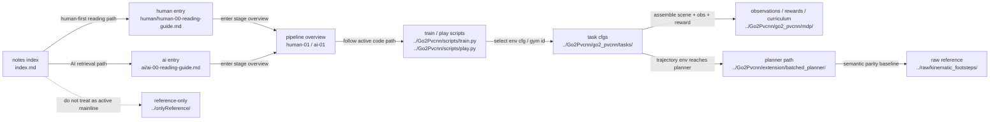

# TestPvcnnWithIsaacsim Notes Index

v35设计前证据：候选姿态与请求存在两处level保留；冻结130固定±.1rad并贯通请求后原约束内事务通过(maxdq.03166rad)，非物理成功。设计为固定有界姿态候选＋同一预测/执行姿态＋原跨后恢复，详见docs/superpowers/specs/2026-10-15-m1-bounded-crossing-attitude-design.md。未实现/未部署，candidateSHA保持v34，无native/生产，下一具体计划和TDD。

v34已结束且0跨越：4记录/3完整失败/3锁定，原始归档双方SHAba2001283bbc209910d865bdeef8280685ecef290179ffceb2f6d377ce3168db。活动XY对齐成功但未离地；冻结130全部IK可解却支撑载荷候选全淘汰，适度倾斜静态候选有解但执行链尚未一致。下一核对支撑姿态/COM/执行结构，不降低安全门槛。见最新log/2026-10-15-m1-active-xy-native-diagnosis.md；当前无native/生产训练，旧运行中段落已过时。

v34最新已启动隔离实测：985CPU通过312.94s，唯一review阻断修复，runtime/archive SHA验证；runner428984/native428986于2026-10-15T00:40:59Z运行，evidence-first-obstacle-active-xy-v1。禁止重复启动或覆写candidate，生产未动；真实10cm跨越/恢复尚未确认，继续读同PID终态与完整证据。

v34最新：独立anchor及requestedXY证据链接入，最终review Important经反例RED/GREEN修复；26相关＋2补充分支通过，完整985测试runner426312进行中。candidate仍v33，尚未新native/生产；完成回归后直接隔离实际10cm验证。旧段落为历史，真实跨越仍OPEN。

v34首次LIFT实测XY起点：5有效RED→7GREEN；只local/CPUoverlay最小实现，相关回归进行中。独立锚点审计未接入，未部署原生，candidate仍v33。保留原限速/安全，无生产训练，真实跨越OPEN。见[实施](log/2026-10-15-m1-active-horizontal-anchor-implementation.md)。

T306/teacher/active-horizontal-anchor OPEN：[冻结诊断](log/2026-10-15-m1-active-horizontal-anchor-diagnosis.md)五帧复现原解，半幅修正活动轮水平误差可保持原IK/关节限速，完整瞬时对齐超速禁止。下一首次LIFT实测XY起点＋有界事务衔接设计；当前runtime未改、无新原生/生产训练，不把静态可解当跨越。

v33实测终态：exit0但FAILED_DIAGNOSTIC，4记录/3完整失败/3锁定/0成功，未完成全分母。原始视频/trace/log已归档，双方SHA f811ccf989893b8c3a9b610f0a12bf932c814cd8ead59bc3f2b528f842b7960c。当前无原生运行、不生产训练。新冻结线索：进入LIFT119活动轮完整目标X比实测后退39.22mm、Z低1.02mm；129仍后退33.21mm、Z仅高1.21mm。完整目标不等于限速后实际动作；尚未证明因果。下一核对阶段切换锚点/接触中水平追踪与倾斜载荷的耦合，不盲改PD或放宽安全。 见[当前证据](log/2026-10-15-m1-support-height-origin.md)。

最新v33支撑高度捕获原点：23RED→182相关通过，可选几何路径已实现，950回归进行中；教师生命周期及独立审计尚未接入，禁止部署/新native。candidate仍v32，无生产训练，跨越OPEN。见[当前](log/2026-10-15-m1-support-height-origin.md)。

v32最终已退出exit0：0成功、3锁定，frame130预测目标承载不足但实际三支撑仍>30N；134锁定，physical_failure=false，四审计errors=[]。原始归档双方SHA2e094f42f358d4a2caa118215f573709924b256fd429026427558408c57aa3cb。膝边界执行问题缓解但机身下沉、活动轮未离地，继续定位目标/实际执行耦合；不生产训练/不重启。见[当前日志](log/2026-10-15-m1-support-knee-reserve.md)。以下运行中状态为历史。

v32最新：927相关CPU通过192.07s、审查无阻断，两个runtime SHA与归档核验后唯一runner411683/python411685正在隔离10cm原生验证，prefix evidence-first-obstacle-knee-reserve-v1。未生产训练/未宣称成功，禁止重复启动。见[当前日志](log/2026-10-15-m1-support-knee-reserve.md)。以下未部署叙述为历史。

最新v32仅候选排序改进：同等预测承载下优先三支撑腿膝余量，原控制/安全门槛不变。独立审查无阻断，77定向通过；最终927回归进行中，尚未部署原生。v31原始归档保留，真实跨越仍OPEN，不启动生产训练。见[当前日志](log/2026-10-15-m1-support-knee-reserve.md)。以下为历史。

最新 v31 实测已退出exit0：FAILED_DIAGNOSTIC，4记录/0完整/3锁定/0成功，env1第139帧失支撑；四份审计errors=[]。原始源码/视频/证据归档双方SHA3e77947bd4954314777a1af35e685c1e641a56658875e5c986df55fe66c5efb0。只读定位左后膝目标贴.1rad、支撑fraction约1%；冻结几何与限速heave对比已保存，非物理成功。下一步核查名义姿态到执行几何的可达性与支撑余量，不自动重启或生产训练。913相关CPU通过不等于实际跨越；裸pytest依赖限制保留。见[当前日志](log/2026-10-15-m1-bounded-support-heading.md)。以下运行状态为历史。

最新v30已部署：827完整CPU及34扩展测试通过，审查I1反例修复；5runtimeSHA一致，GPU1MiB/无并发后唯一runner388660启动evidence-first-obstacle-active-intent-v1实际10cm。初始化已现场核实，未跨越成功，勿重复启动；无生产训练。以下未部署状态为历史。

最新v30活动抬腿意图原子提交：v29已终态归档，0成功、env1 frame138锁停；不重启旧进程。v30保留支撑步长/全部安全阈值，将可行活动轮目标独立提交；34针对性CPU通过，独立审查I1物理参考审计缺口已2RED→GREEN修复，完整回归进行中，尚未部署/启动原生。无生产训练，真实跨越仍OPEN。见[当前日志]( log/2026-10-15-m1-active-intent-commit.md)。以下运行状态均为历史。

最新v29有界姿态IK初值恢复：18相关/806完整CPU通过，review C0/I0/M2保留；三runtimeSHA一致，v28终态归档0success后GPU1MiB，唯一runner381178已启动evidence-first-obstacle-seed-recovery-v1隔离10cm实测。未生产训练，不能据CPU通过称跨越。见[当前](log/2026-10-15-m1-bounded-seed-recovery.md)。以下v28运行状态为历史。

当前v28活动轮独立执行步长：完整788CPU通过133.91s，独立审查C0/I0；支撑历史/解码保持16通过。5文件本地远端SHA匹配，GPU1MiB后唯一runner376678已启动evidence-first-obstacle-active-progress-v1隔离10cm实测，勿重复启动。v27完整归档0成功，v28尚无成功证据；无生产训练。见[当前](log/2026-10-15-m1-active-execution-progress.md)。以下旧运行状态为历史。

v27最新已启动：772CPU通过143.49s，review C0/I0/M1，样本与原始traceSHA匹配；唯一runner368879/evidence-first-obstacle-ik-tangent-v1正在隔离10cm实测。未生产训练/未实际成功，勿重复启动。见[实施](log/2026-10-15-m1-ik-active-tangent-implementation.md)。

最新v27：v26完整4×142帧/0成功，137帧左后边界求解停滞；归档双方SHA2b458d11。保持原目标/边界/32预算的约化髋关节候选使真实失败帧可解，6RED→75GREEN，完整772进行中；独立review C0/I0/M1，未v27原生/无生产训练。见[实施](log/2026-10-15-m1-ik-active-tangent-implementation.md)。以下为历史证据。

最新冻结证据修正v25归因：左后不是已证实不可达，当前IK因knee候选越.10rad就整腿拒绝。保持原目标/限速/.1mm残差，合法边界候选步使123/126残差.158/.281降至.047/.067mm；正常118/120/122不变。仅CPU诊断，未runtime/native变化，下一受限IK步进反例与修正。见[诊断](log/2026-10-15-m1-ik-boundary-step-diagnosis.md)。

v25最终：729CPU/审查C0I0后唯一10cm实测4×132帧，0成功/3锁停，env1 frame123开始左后IK残差超.1mm，伸直保护余量近0，127五次失败锁停；该帧三支撑承载均足，无碰撞穿透，活动轮仍未有效抬起。四路审核errors=[]、exit0/进程已退出。下一冻结支撑目标与可达余量诊断，不放宽门槛/不生产训练，跨越OPEN。见[证据](log/2026-10-15-m1-support-translation-decoupling.md)。

最新v25：冻结v24同帧数据定位支撑XY中的姿态项反转移重心方向；仅LIFT/PASS支撑平移使用实测姿态，保留独立Z/载荷和RESTORE旧行为。729CPU通过，三runtime本地candidateSHA一致；独立最终审查中，未v25原生/生产训练，跨越OPEN。见[实施证据](log/2026-10-15-m1-support-translation-decoupling.md)。

最新v24最终：712CPU/审查修复后唯一10cm实测4×136帧，0跨越/3锁停，input130右后29.53047N触发frame131保护；四路审核errors=[]，exit0/GPU1MiB。完整归档双方SHA17e7f69f2431ca65e1d220345d077613c3bc27d2cd23ce9501418ed19c72c8dd。冻结分配对照发现未触发缺载前姿态偏好收缩RR，补载开始仍有历史正偏移；非唯一物理因果证明。下一检查执行与承载时滞，不放宽安全/不生产训练，目标OPEN。见log/2026-10-15-m1-load-priority-attitude.md。

最新冻结诊断：直接补回独立姿态Z回路会与承载反馈争用。v23输入131右后34.86N/目标93.85N要求向下补载，候选姿态offset却向上、与load合成+2.813mm（非最终世界Z）。草案未部署；下一统一承载约束分配，不盲叠加增益。无runtime/native/训练变化，GPU1MiB，目标OPEN。见2026-10-15-m1-attitude-load-conflict日志。

v23最终：唯一10cm实测4×137帧、0成功/3锁停，input131右后16.3886N导致frame132保护，活动轮底最高约0.0501mm未有效抬起。四路审核errors=[]，exit0/GPU1MiB；完整归档双方SHA6d81735b1ee70cf56adfd44593f41870352abb6c2882c2b6dd63ecaa2fe9188b。固定支撑Z对0.001rad roll/pitch指令的竖直响应被冻结CPU复算证实近0，水平响应保留；下一支撑姿态通道结构诊断，不盲增步长/放宽安全。无生产训练，跨越OPEN。

v23最新已实际启动：独立review C0/I0/M1，669CPU通过，runner343169/python343171于19:13:03Z运行唯一evidence-first-obstacle-backtrack-refined-v1；场景初始化中，尚无跨越结果。额外200合成回合probe全suite主动取消且不算通过，核心回归/审查已完成。无生产训练，勿重复启动。[日志](log/2026-10-15-m1-backtrack-refinement.md)。

最新v23回溯细化已实现：669CPU通过/本地candidate3runtimeSHA一致；独立最终审查进行中，尚未原生v23/生产训练。实际fraction统一提交load/height/heave，粗8级后至多4次安全细化，限速不变。跨越OPEN。[实施](log/2026-10-15-m1-backtrack-refinement.md)。

最新冻结执行链诊断：四帧CPU重放beta与原生一致，IK均可解，粗二分因膝关节略超0.05rad而丢掉近半合法步长；不改限速的网格反事实使125/130/138执行Z由低于轮心转为高于轮心，114仍有12.8mm历史目标差。仅CPU诊断，无runtime/native/训练变化，跨越OPEN。见[回溯诊断](log/2026-10-15-m1-execution-backtrack-diagnosis.md)。

v22最终：660CPU/独立审查修复，唯一10cm4×144帧0跨越/3锁停；输入138RR27.8249N导致frame139保护，活动轮未有效离地。四路审核errors=[]、exit0/GPU1MiB；完整归档双方SHA53e62bac。新线索为最终活动腿执行插值仍低于实测轮心，下一冻结复算joint连续性与回溯，不笼统归因IK。无生产训练，目标OPEN。详见[最终证据](log/2026-10-15-m1-active-contact-load-diagnosis.md)。

当前v22 active-contact-load实施：冻结v21发现待抬轮仍承重69N时旧分配遗漏其力矩，目标COP偏离6.27/3.34cm；现修正为总力乘COM比例减活动接触力矩，保留45N投影/速率/安全。35单元+29事务审核通过，完整回归/独立review进行中，未新native或生产训练。[诊断](log/2026-10-15-m1-active-contact-load-diagnosis.md)。

当前v21：[公共支撑升降](log/2026-10-15-m1-support-heave.md)。635CPU与独立审查补测完成，真实4×143帧0成功/3锁停，RR27.683N触发frame138保护、活动轮未有效离地；四路errors=[]，exit0/GPU1MiB。完整归档SHAd908da07。高度较旧同帧改善但支撑更早失败，下一查差分姿态与载荷分配；无生产训练，目标OPEN。

最新结构诊断：v20固定世界Z使1mm机身抬高指令对支撑Z的响应归零，取消竖直纠偏；env1 rootZ .599→.401m，frame140因实际COM余量不足冻结。下一分离机身公共支撑与载荷差分，非简单放宽门槛或加增益；还未实施新方案。

v19最终：538相关CPU通过，隔离4×135帧0跨越/3锁停，首次frame130右后29.464N失载，无碰撞，活动轮仍贴地；四路审核errors=[]，exit0/GPU1MiB。弱RR最终执行目标仍高于实测1.691mm，反馈未抵消几何冲突。完整归档SHA5505ae0f1bdf4296c862d6115460442fc54bcd04089b95e6e1b861416900c784。见[最终日志](log/2026-10-14-m1-support-load-feedback.md)，总目标OPEN；下方运行中为历史。

最新：用户授权直接执行v19实测载荷闭环，实施与独立审核见[日志](log/2026-10-14-m1-support-load-feedback.md)。回溯重复缩放Important已RED/GREEN修复，最终回归待结束；未新native/生产训练。下方待架构审批为历史，不重复询问。

最新只读诊断：v18同帧执行目标对FR/RL压低20.2/14.6mm、对弱载RR抬高0.54mm；下一步RR29.75N失载，无碰撞。所记录最后子步未扭矩限幅。详见log/2026-10-14-m1-v18-support-execution-diagnosis.md；下一架构讨论为实际载荷闭环，未改runtime/未新native/训练。

2026-10-14 v18已完成隔离10cm实测：4路计入、0完整跨越、3路锁定失败；首次env1/frame129 support_lost，右后29.7507N、无碰撞，活动轮仍贴地。IK末有效帧执行目标与解差0.028mm不等于物理抬升。495相关CPU通过/独立审查无阻断；原生exit0/GPU1MiB，四路审核errors=[]。完整归档SHA1fa550c74b73462a73dbd7db0200dd44f03666a8814edaecee7e8d9c9edce601。本目标OPEN，无生产训练。详见log/2026-10-14-m1-measured-execution-reconciliation.md；旧运行状态仅历史。

最新v17实测结束：4路0跨越，3路进入LIFT但未真正离地，env1/input132右后26.15N触发support_lost；全部记录审核errors=[]但物理失败。runner298788已退出0/GPU1MiB，无训练。当前预测47.43N、选中目标36.75N却按满储备推进是下一诊断线索，未据此直接改控制。视频/JSONL已完整归档并SHA核验，详见soft-target实施日志。

最新2026-10-14：用户已确认45N软目标，v17已实现；424相关CPU通过/独立审查无CriticalImportant，保持30N保护。12:27:26Z隔离原生runner298788在evidence-first-obstacle-tripod-soft-target-v1直接4路10cm测试，尚未成功。见m1-tripod-soft-target-implementation日志。下方“待确认”已过时，不重复审批，不启生产训练。

最新2026-10-14实测：三轮储备v16已实施，421相关CPU通过；直接10cm四路均在BALANCE失败、未进入LIFT，最优候选44.58/44.98N被45N硬筛选排除，IK可解。原始证据保留，同后端全记录复核errors=[]但全部success=false。详见tripod-load-reserve-implementation日志；无生产/训练，目标OPEN，45N改优化目标的下一设计尚未实施。

最新：用户确认后[三轮储备已进入实施](log/2026-10-14-m1-tripod-load-reserve-implementation.md)，控制相关412CPU/独立证据20通过，最终回归与独立review进行中，尚未新native/生产/训练。下方待计划审批为历史，不重复审批。

最新：三轮储备具体规格已确认；[四任务计划](../docs/superpowers/plans/2026-10-14-m1-tripod-load-reserve.md)已写并自审，沿用主代理inline＋最终独立review，待计划审阅。仅文档，未runtime/新native/训练；不重复规格审批。

最新2026-10-14：[三轮承载储备只读诊断](log/2026-10-14-m1-tripod-load-reserve-diagnosis.md)：首次LIFT四轮实测右后96N，但排除左前后准静态估算仅18.85N<30N；几何10mm/四轮有力不等于可安全抬去一轮。新子节点tripod-load-reserve OPEN，拟统一滚动支撑选择和抬轮储备，架构讨论待确认；未runtime/native/训练变更，不把静力估算当真实载荷或成功。

最新2026-10-14：[活动腿实测IK已实施并实际10cm验证](log/2026-10-14-m1-active-leg-measured-ik-implementation.md)。374CPU通过/独立审查重要项RED→GREEN；4×123帧，活动腿目标方向已纠正但仍贴地，右后26.98N<30N导致1路锁停/3路中断，零碰撞/跨越。新节点diagonal-support-loss-after-measured-ik OPEN；exit0/GPU1MiB，未生产/训练，旧审批/运行中状态为历史。

最新2026-10-14 active-leg-command-frame PLAN REVIEW：规格已确认；[四任务实施计划](../docs/superpowers/plans/2026-10-14-m1-active-leg-measured-ik.md)已写并自审，主代理inline＋最终独立审查。计划待审阅，未runtime/新测试/原生/训练；不重复规格审批。

最新2026-10-14 active-leg-command-frame SPEC REVIEW：[分腿IK规格及参数核查](log/2026-10-14-m1-active-leg-measured-ik-design.md)。用户批准修正/实测方向，744帧动作/步长/限速及原生PD未发现误配；分腿实测IK＋有界衔接书面细化待审阅，未runtime/新原生/训练。不再新增卸载前置。

最新2026-10-14：[活动腿执行坐标诊断](log/2026-10-14-m1-active-leg-command-frame.md)259/259未锁停LIFT采样接受角在实测机身下指向更低轮心；动作下发一致，IK满足的是虚拟机身目标。活动腿/支撑腿统一坐标分配为新定位点，非独立卸载目标。只读CPU反事实支持分离方向但有超步长跳变，不可直接执行；未runtime/原生/训练。

最新2026-10-14：[动态支撑/实测抬轮已实施并实际10cm验证](log/2026-10-14-m1-dynamic-support-implementation.md)：319相关CPU通过；4×186帧，支撑保持改善但目标轮仍贴地，1接近保护锁停/3同批中断，零碰撞/跨越。原生exit0/GPU1MiB，源码视频归档已核SHA。生产/训练未改，实际卸载/经过仍OPEN。

最新2026-10-14：[动态支撑实施计划](../docs/superpowers/plans/2026-10-14-m1-dynamic-support-measured-lift.md)已按确认规格写成并自审，待计划审阅；主代理实施＋独立审查，随后直接10cm实际过障。当前仅文档，未改runtime/服务器/训练。

最新2026-10-14：[动态支撑＋实测抬轮规格](log/2026-10-14-m1-dynamic-support-design.md)已按用户选择写明并自审，待书面审阅。仅设计，未改runtime/服务器/训练；保留原保护和直接10cm验证路线。

最新2026-10-14：[滚动抬轮解耦已实施并实测](log/2026-10-14-m1-rolling-lift-decoupling.md)，243相关CPU/独立审查通过。4×125帧，env0跨过旧冻结点、额外6帧推进轮参考，但目标轮未离地，COM余量后降至8.9mm、右后轮25.8N触发保护；1失败/3同批中断，零碰撞/跨越。原始视频源码归档，修正诊断前缀误报后4记录errors空；未生产/训练。下一步实际过障载荷再分配，不重做单独支撑。

最新2026-10-14：[滚动抬轮门控定位](log/2026-10-14-m1-rolling-lift-gate-diagnosis.md)确认1cm机身位置跟踪同时冻结抬轮参考；同帧姿态仍在原限内、所录最后子步无力矩裁剪。推荐分离机身纠偏与抬轮进度，属此前明确保留门槛的控制修订，待确认；本轮只读，无新runtime/native/训练。

最新2026-10-14 UTC：[低速滚动实测](log/2026-10-14-m1-slow-rolling-crossing.md)按用户确认改为0.05m/s平滑接近/滚动移重心抬腿/跨后恢复，229相关CPU通过。4×178帧均进入LIFT但轮仍贴地承重；root误差越1cm后冻结抬升，env0未清障接近保护锁停，其他三行同批中断，零碰撞/零成功。视频源码归档核SHA、原生退出/GPU1MiB；生产/训练未改。下一步实际跨越内修rolling-lift-tracking-freeze，不重做独立支撑。

最新2026-10-14 UTC：[机身/轮速分离实际过障](log/2026-10-14-m1-body-wheel-allocation.md)213相关CPU通过，4×107帧无碰撞但仍无LIFT/跨越；支撑轮实动后所有候选margin不足10mm，3锁定+1同批中断。视频/原始记录已归档核SHA，原生退出/GPU1MiB。未放宽门槛，生产/训练未改，下一步仍直接障碍内修控制。

最新2026-10-14 UTC：[第一处10cm障碍反馈对照](log/2026-10-14-m1-obstacle-anchor-feedback.md)按用户要求直接跑完整障碍流程，不再单独反复支撑/抬腿试验。第三轮4×182帧尚无LIFT，机身跟踪冻结后env1–3前轮碰障，env0同批中断；共同轮速改锚点误差未解决跨越，不能发布为修复。证据收尾状态见该日志，生产/BC/PPO未改。

最新2026-10-14 UTC：[两轮10cm实际诊断](log/2026-10-14-m1-dual-support-final-validation.md)均已结束/GPU释放。最小参考衔接修正消除frame41切换拒绝，68针对性测试通过；第二轮在frame97暴露实测支撑轮位移后无可行三轮目标，尚未LIFT/未跨越。候选改动未提交、生产/训练未改；下一步针对实际支撑位移，不重复前置全套。

最新2026-10-14T06:24:16Z：用户改为实际跨越优先，已直接启动第一处10cm障碍的4环境限时诊断，未启动训练。已知恢复时钟证据问题不再阻挡物理观察，但正式A/BC仍不放行；见[实际跨越诊断](log/2026-10-14-m1-dual-support-final-validation.md)。下方停止/NOT_RUN为启动前历史。

最新2026-10-14 UTC：[最终验证/原生阻塞](log/2026-10-14-m1-dual-support-final-validation.md)。候选02a70cf相关532CPU通过，原生控制合同通过；准备关暴露physics-callback-clock-quantization，四行各91帧部分记录后主动停止，后续抬落/跨越/A均NOT_RUN。GPU已释放，生产/训练未改。下方设计/审批状态为历史。

最新2026-10-14 UTC：[共同实施计划](log/2026-10-14-m1-dual-support-crossing-recovery-plan.md)已写并自审待计划审阅；两份规格已确认，沿用子代理。0.3秒/1cm是跨后整机验收，不逐腿加等待；未runtime/服务器/原生/训练变更。

最新2026-10-14：[跨越优先与0.3秒恢复设计](log/2026-10-14-m1-crossing-recovery-outcome-design.md)：用户最终确认0.3秒而非1秒，整机跨完后在前进中验收，不给每腿加等候；书面细化待审阅/未runtime。新host root@a21506654554025984756592尚未连接，不沿用旧PID；Teacher A/BC/PPO仍未通过。

最新2026-10-14：[10-14快照发布](log/2026-10-14-m1-release-10-14.md)按用户要求优先，README区分已实现/验证局限/已批准待实施。双几何书面规格已确认，实施计划未完成；未runtime/服务器/训练变更，后续无需重复规格审批。

最新2026-10-14 UTC：用户确认双几何筛选方向，[书面规格](../docs/superpowers/specs/2026-10-14-m1-dual-support-selection-design.md)已自审待审阅；固定IK锚点、PD/包络/真实ready不变，拟仅扩展候选筛选及对应证据。[设计记录](log/2026-10-14-m1-dual-support-selection-design.md)。尚未runtime/新native/训练，不把几何候选当跨越成功。

最新2026-10-14 UTC：[准备目标停滞调查](log/2026-10-14-m1-measured-support-selection-diagnosis.md)确认v4 env1连续969帧选择上一参考125；旧锚点预测合格而实际准备未达。CPU冻结几何及独立审查支持“双支撑几何候选筛选”新修订，非物理成功、尚待设计确认；runtime/生产未改，未新native/BC/PPO。

最新2026-10-14 UTC：[显式后端复核与v4原生](log/2026-10-14-m1-feedback-backend-native.md)de46186修复/相关测试/独立审查及新合同通过，3049帧逐记录证据errors空；控制/物理未改。wheel0准备env0连续6帧达标，另三行20s仍未ready（最大实际COM9.598mm<10mm），后续抬落/10cm未跑；真实支撑几何跟踪为当前阻挡，Teacher A/BC/PPO仍BLOCKED。下方“待确认”为历史。

最新2026-10-13：[有界反馈实现](log/2026-10-13-m1-teacher-bounded-feedback-implementation.md)及限定复审完成39a6590；[v3原生](log/2026-10-13-m1-teacher-bounded-feedback-native.md)合同通过，env0实际ready44–49，但反馈事务证据不一致触发停止，后续NOT_RUN。Teacher A BLOCKED，未抬腿/未BC/PPO/未生产部署。以下旧实施中状态仅为历史。

最新[固定ABAD/8维实施](log/2026-10-12-m1-fixed-abad-eight-action-design.md)：用户最终fresh从0，撤销200迁移。399cf7b/235相关CPU/审查2项修复/5stage原生通过；11runtime逐SHA部署，新PID10660/run20-55-34实际0–3轮/8维/2048/loss有限。model0 CPU39有限模型/33新Adam(step20)/8正std/stage0/v3完整；TB10838/remote6006已指新run。固定目标非锁死，旧PT保留。下方暂停与200续训均历史。

最新12:13UTC[空地200/500对比](log/2026-10-12-m1-stall-slip-design.md)：训练按用户要求已停止，监控PAUSED。相同初始观测/确定性推理/实测2秒，200前进.580m偏航.43度，500前进.123m偏航-74.42度并目标抖动/承重恶化。发现演示入口额外物理步进，隔离诊断去掉后退化仍在；生产未改，不据此断言碰撞惩罚唯一原因。下方6598运行记录为历史。

最新[原地/打滑双惩罚](log/2026-10-12-m1-stall-slip-design.md)：6d90e80已部署，183CPU/补强原生通过；4885完整600后退出，所有PT保留。用户确认reference model200 stage0/streak1显式迁移，PID6598/run17-28-55实际201–202/2048/loss有限，TB6768新run。双费用仅stage1–3，当前stage0费用0正常，非从零或从249恢复。

最新[参考M1与三项学习反馈实施](log/2026-10-12-m1-reference-learning-implementation.md)：参考姿态已批准替代585mm，14runtime已部署。301CPU/1skip与原生通过；2303保留model100后停，新4885/run12-26-20从零完成0轮、2048/model0新合同/新Adam/stage0核验。TB5041指新run。下文待审批/未部署及2303继续均历史。

最新用户授权三项学习信号及robot对齐；[参考robot审计](log/2026-10-12-m1-reference-robot-audit.md)确认4源USD相同但电机/PD/轮collision/随机化不同，参考姿态与585mm冲突须书面审阅。仅设计，runtime未改，2303继续；下文“候选未授权”已过时。

最新只读[旧wave/IK与自主PPO对照](log/2026-10-12-m1-legacy-wave-learning-comparison.md)：核对ssdsj12/m1 main8aeb845，优先借鉴观测/安全卸载与越过进度，不搬动作接管；保守包络判定待反例审计。生产未改/PID2303继续，新run37仍stage0。

当前部署优先：c7af587/91f104c，PID2303/run2026-10-12_11-20-43从零完成0–1轮，2048/AME+PPO/12腿/.30固定轮/零额外净空/撞障碍重置；model0完整CPU校验新Adam与stage0。TB2468新run，原PT保留。下方待部署均历史。[记录](log/2026-10-12-m1-mirrored-reset-fresh.md)。

用户最新明确：取消额外3cm净空，收腿/摆腿由PPO自行学习；216相关CPU通过，原生零margin接线复验中。从零新训练，不续旧PT。当前状态只认[最新记录](log/2026-10-12-m1-mirrored-reset-fresh.md)。

最新优先：[前后镜像/碰撞重置/全新训练](log/2026-10-12-m1-mirrored-reset-fresh.md)。用户已确认不续训；当前新host a21484122541518848761613，旧训练/演示已停。91f104c与90CPU/4env原生通过，部署与fresh开训待最终核实。以下旧9450运行描述均为历史。

2026-10-12[发布到10-12](log/2026-10-12-m1-release-10-12.md)：用户指定新GitHub分支，README汇总固定轮速12腿/自主抬落/统一密填/动作迁移改进并纠正过时2cm要求。当前9450至4119，model4100完整2048/pass0/2048attempt/0success，未停训或改生产，学习仍OPEN。

最新只读[固定轮速model600窗口](log/2026-10-11-m1-fixed-wheel-model600-window.md)：9450至649/TB651、12腿/.30/2048保持，loss与PT39/Adam33/std12有限。last完整2054回合前进pass.54090/6207attempt/0success；301–651预抬2cm/稳定落轮全0，但rawdelta196轮非零，不是完全无抬轮增量。未停训/改生产/并发probe，具体动态失败原因仍OPEN。

最新部署优先：[固定轮速12腿](log/2026-10-11-m1-fixed-wheel-deploy.md) aea3b32已部署，344CPU/2000原生物理调用/1600环境帧20terminal通过。旧7960在完整700保存后停止；新9450/run17-40-08从显式转换300实际完成301–304，2048/GPU22026MiB/loss有限，真实12action/.30m/s轮驱动，非精确机身跟速。TB9685新run；GitHub d7625ba已push/ref确认，后续文档提交优先。旧“候选未部署/待700”均历史，学习仍OPEN。

最新[固定轮速12腿实施](log/2026-10-11-m1-fixed-wheel-deploy.md)：用户已确认0.30m/s及宽松机身跟速；344CPU/真实300显式转换通过，审查反例修复。等待本run700安全边界及隔离原生，尚未改生产；以下“待审”已失效。

最新[固定轮速/12腿动作设计](log/2026-10-11-m1-fixed-wheel-leg-only-design.md)：用户确认严格12维、不用差速；书面规格待审。0.30m/s为建议，旧300需显式转换。模型无独立车轮yaw转向关节，腿部动态避大障碍能力待验证，不承诺必然可行。尚未改生产/停训。

最新[自主新run500窗口](log/2026-10-11-m1-autonomous-model500-window.md)：至548/TB549，loss有限；500完整2048回合pass0/1376attempt/0success。预抬仅321轮1次、stable/strict全0，具体动作原因未定。PID7960继续，未停训/改生产/并发probe。

最新部署优先：[自主抬落时机修复与model300新训练](log/2026-10-11-m1-autonomous-lift-timing-deploy.md)。stage1–3解耦2cm统计与成功资格，保留三轮支撑/逐帧3cm/稳定落轮、防刷预算。307CPU/1280原生环境帧与20terminal通过；PID7960/run15-51-33从指定300完成301–304，2048/GPU21868MiB/loss有限。TB8190远程新run核实。旧6507已在800边界停止，用户确认的旧400/500/600/700及800共5PT已删除；指定300/其他历史/全部日志保留。以下设计待审批、700续训等为历史，勿据此重启旧进程。实际学习仍OPEN。

最新用户确认自主抬落时机：“提前2cm”为水平距离而非竖直升高；拟取消2cm预抬硬前提，保留净空/支撑/落轮标准。[设计状态](log/2026-10-11-m1-autonomous-lift-timing-design.md)。仅书面规格，尚未实施/部署，不因此暂停训练。

最新[抬轮逐帧诊断](log/2026-10-11-m1-prelift-failure-trace700.md)：700安全保存后暂停4921；2048训练态只采样复现1次左前预抬，+.02s支撑轮载荷全0首先失败，+.08s早落轮，且预抬已偏离轮轨/增量奖0/全程无重叠。非碰撞或恢复门槛；不外推全部历史事件。probe均退出，生产未改，从700恢复PID6507/run15-16-31，701+9299/2048；07:18UTC已完成701–702/loss有限/GPU21868MiB，TB6661远程新run核实。

用户询问零跨越：[只读判定链诊断](log/2026-10-11-m1-zero-crossing-diagnosis.md)。至651预抬2281，但严格跨越事件本身仍0，不只是恢复姿态门槛；存在不足3cm的重叠净空样本，目标重叠暴露下降/轮轨代价升高。50部署CPU测试通过，具体动作失败须当前策略逐帧追踪；PID4921未停、奖励未改。

06:47UTC[model600完整窗口](log/2026-10-11-m1-dense-model600-window.md)：训练至640，预抬累计2251但stable/strict仍0；当前run600 CPU校验完整，last2048回合前进pass0/3106attempt/0success，是真实完整窗口退化而非图表小数。PID4921/2048仍运行，未停训或改奖励。只记录风险，不凭汇总猜动作原因。

05:46UTC新证据：[密填预抬重复性](log/2026-10-11-m1-dense-prelift-repeatability.md)。301–403原始计数在11轮出现18次>=2cm单轮预抬，stdout交叉一致；稳定落轮/严格成功仍0，不是学会。model400完整CPU核验，PID4921持续训练/2048/GPU21868MiB，未停训或并发probe。此信号已通知一次，不重复提醒。

现场确认：新run13-17-21/bb57e7d，PID4921已完成301–304，loss有限/2048env/GPU21868MiB；TensorBoard5109已指新run，remote6006核实，local16006拒绝连接（未改隧道）。[部署记录](log/2026-10-11-m1-lift-roll-self-learning.md)。初始严格成功0，仍在学习。

最新用户要求“长训先，让它自己来折腿”，静态折腿夹具不再作为开训条件；已部署统一8目标+70填充并切换训练selector，233CPU通过，从所选model300启动PID4921，2048env/optimizer/std/course保留。实际更新/容量以[自主学习部署记录](log/2026-10-11-m1-lift-roll-self-learning.md)现场核验为准。下方未部署/夹具阻挡开训均历史，严格跨越标准不变。

最新[诊断修复](log/2026-10-11-m1-placement-diagnostic-repair.md)：承重空地逐帧对照替代未承重标称误判；232CPU通过，96恢复摆放/原有runtime readiness通过。静态折单腿空地56tick仍失去三轮支撑，单列inconclusive_fixture，不能当布局不可行。生产未改、未开训；恢复点仍用户所选300。后续OPEN为有效三轮动态夹具，不再重复首点共同下沉诊断。

用户最新恢复点选择优先：[model300前进基础](log/2026-10-11-m1-model300-restart-selection.md)。已核实当前谱系18-49-19/model300完整，stage1、上一2048回合pass1.0但strict0；后续选择next301+9699，保留optimizer/std/course，覆盖旧“只从1400恢复”。model1400保留备份；新布局native门槛未解除，目前未开训。

现场状态优先：model1400完整校验后PID948/边界helper已退出；训练暂停，生产未切换。统一8目标+70填充只变高度，214CPU通过。首个原生恢复摆放和同设置空出生区对照均geometry/support通过、pose漂移超诊断界限；整套native未通过，不可把无障碍也复现的失败当布局不可行，也不可自动恢复候选。[结果](log/2026-10-11-m1-lift-roll-native-screen.md)。以下“等待1400/训练运行”均历史。

用户最新修订优先：stage1–3统一8目标+70填充、完全相同XY/水平尺寸，只变3/6/10cm高度；stage0/mixed4不变。214相关CPU通过，候选仅隔离目录，旧4/6/8图不部署。[当前记录/图](log/2026-10-11-m1-lift-roll-native-screen.md)。1400边界暂停保护仍有效。

当前实施优先：[原生筛选准备](log/2026-10-11-m1-lift-roll-native-screen.md)。213CPU回归通过，早期碰撞/侧壁假支撑测量问题已修复；生产未切换。单次有界helper等待model1400校验后仅暂停PID948，再核实GPU释放；禁止并发probe/重复启动，不重审已确认方案。

后续证据优先：[整机转向/轮距与抬轮包络检查](log/2026-10-11-m1-fullbody-candidate-search.md)。20cm候选在56个配置层的有界搜索未找到完整地面绕行，2988个源mesh假想折腿/平移/恢复位置未发现障碍相交；可进入隔离authoring/原生筛选，尚未部署，不宣称全姿态不可绕行。2cm版仍拒绝。用户审批已完成。

最新实施：[密填候选门槛检查](log/2026-10-11-m1-lift-roll-candidate-gates.md)。动作/书面规格/角色均已批准，用户选当前镜像逐项执行；角色47CPU通过，候选15测试通过。但2cm填充缝仍可形成滚行高台，20cm对照又出现潜在地面绕行，均未取得整机防绕行验证。暂不部署/发布此候选，不重复请求旧审批，生产PID948未动。

书面规格已获用户确认。规划时CPU复现[外围填充角色冲突](log/2026-10-11-m1-fill-role-contract.md)：轮轨外small会被当作必跨目标并报错。待新增最小角色约定：目标计必跨、填充仍参与碰撞/感知/落轮安全但不产生无关必跨义务。原动作方向不再待确认；尚未改生产或停止训练。

最新已确认设计：[单轮抬升、三轮滚行、同侧前后轮跨越后左右交替](log/2026-10-11-m1-lift-roll-design.md)。不使用 swing/动作接管；旧横贯轮轨示意图作废。仅书面设计，尚未改地形；支撑/落轮包络与防绕行须同时验证。现场 PID948 持续训练、存在 model1100，不能因新设计自动重启。

最新只读信号：[本run首个预抬事件](log/2026-10-11-m1-first-prelift-event.md)。1030轮prelift_events原始计数1，事件定义为重叠前单轮底增高>=2cm且其余三轮接触；稳定落轮/严格成功仍0，无逐帧视频验收，不能称学会。PID948持续训练，未改生产/未并发probe。

最新主机恢复：[replacement-host resume](log/2026-10-11-m1-host-resume.md)。用户确认接着训；新host a21472797434572800304964，model1000完整核验/173CPU通过，PID948从1001恢复，run10-56-34，2048env/optimizer/std/course保留。旧17722/17849和旧主机仅历史；实际推进核实见记录。

发布核实：`m1-10-11`已普通push并独立ref确认`5a366ff`，包括新密度布局、此前a8923f2轮轨修复和README；新训练PID17722已完成1010，loss有限但无2cm/严格恢复。旧m1-10-10待上传状态不再适用。

当前用户变更：[加密课程并保留策略续训](log/2026-10-11-m1-density-resume.md)。3/6cm阶段改4/6个、pitch1.2m；10cm保留8个并调整落轮空间。173CPU回归/4env原生验证通过，独立审查无阻断。已在校验model1000后停止16830、部署，PID17722实际完成1001，run10-28-16/bb57e7d，2048GPU0约21.9GB，optimizer/std/stage1保留；TB17849/local16006核实。用户指定上传m1-10-11并更新README，取代旧m1-10-10待上传指令。以下16830为历史，最终部署状态以新记录为准。

最新状态：[持久轮轨处罚修复](log/2026-10-11-m1-persistent-route-repair.md)。用户已确认修复并恢复，不再重复请求授权。173CPU回归、真实轨迹反事实、独立审查及4env原生接线/策略回放均通过。新PID16830已核实完成901--905，run2026-10-11_09-57-29/bb57e7d，2048env/GPU0约21.9GB，总10000/save100，model900同谱系optimizer/std/课程保留。TensorBoard16981已切换，local16006核实。实现a8923f2已本地提交，GitHub首推443超时待重试；服务器训练不受影响。实际跨越仍未验收，以下暂停待确认均为历史。

历史部署：[model700与上传核实](log/2026-10-10-m1-model700-publication.md)。修复实现0286e95及文档已上传m1-10-10，远端随后核实3cc82b3；后续model900暂停状态以上方记录为准。

最新已授权：[持久跨越奖励修复](log/2026-10-10-m1-persistent-crossing-repair.md)。未完成同侧前后轮严格恢复，绕过后仍屏蔽正奖励；实际单轮增量延伸到障碍顶+3cm。验证后从本次model600恢复，实际PID/run以部署记录为准。以下等待确认/旧PID均为历史。

最新：[model600真实策略接触回放](log/2026-10-10-m1-model600-contact-replay.md)。修复后仍无2cm预抬，已在校验model600后暂停PID12707。4env均值/采样各1000步均无严格跨越；实测策略伸腿抬机身，关节/高度恢复门槛真实不满足。待奖励防绕过设计，勿按下文旧PID自动重启。

最新已授权修复：[恢复判定/增量抬轮/地图保真](log/2026-10-10-m1-recovery-prelift-pooling-repair.md)。212相关回归、4环境原生恢复/地图/奖励接线通过；model_500边界部署，恢复本次谱系并上传m1-10-10。实际跨越仍未验收，以下“尚未修复”为历史诊断。

最新只读诊断：[感知与奖励接线](log/2026-10-10-m1-perception-reward-diagnosis.md)。确认默认无debug路径的robot未赋值异常被吞，稳定恢复/晋级被阻断；不解释所有零预抬。CPU复现完成，尚未修复或停训。

最新：[跨越奖励与轮轨障碍修正](log/2026-10-10-m1-required-crossing.md)。旧8573已停；134相关测试、原生奖励接线通过；用户要求从零2048/10000，禁止续接旧模型。以下部署叙述为历史。

最新用户变更：[取消速度误差晋级门槛](log/2026-10-10-m1-remove-speed-gate.md)。20项测试通过；PID8491等待7747保存model_500后续训切换，尚未宣称运行进程已生效。速度误差保留为诊断。

最新：[平地先行课程，从零2048纯PPO](log/2026-10-10-m1-flat-first-curriculum.md)。118测试和最终原生验证通过；新PID7747运行，实际2048环境stage0障碍0，model_0已保存。平地→3/6/10cm→混合地形，按能力晋级，尚未学会跨越。

当前：[用户确认585mm整机高度并要求从零重训](log/2026-10-10-m1-585mm-stance.md)。99测试与4环境5秒静立通过（最大倾角0.438度）；新训练PID6169，2048环境10000轮，不加载旧模型。实际抬轮/跨越仍待验证。

最新奖励排查：[5cm窄障碍在15cm采样间隙漏奖励](log/2026-10-10-m1-ppo-narrow-probe-repair.md)，7例复现，117测试及2048两轮通过；model_302恢复长训，启动PID4930。跨越效果待观察。

当前更新：[2048环境与每环境前向交替障碍](log/2026-10-10-m1-dense-forward-2048.md)。

2026-10-10 用户已改为纯 PPO：停用 MPC/模仿/动作接管，只调整奖励和地形。
以下 WBC 门槛是历史诊断，不再阻挡健康检查后的 PPO 长训。
[当前验证与监控](log/2026-10-10-m1-pure-ppo.md)。实际跨越能力尚未验证。

当前接触转换证据：[接近中的零受力点被过滤](log/2026-10-09-m1-wbc-patch-transition-history.md)；
[释放点预测改用材料点加速度](log/2026-10-09-m1-wbc-released-material-bias.md)，200项WBC测试。
直接释放旧点仍不满足原力矩约束，不能上线或启动长训。

M1 最新执行证据：[WBC 分层制动与接触转换诊断](log/2026-10-09-m1-wbc-base-priority.md)。
197项WBC测试；显式诊断分层抑制倒向加速，但多点接触转换仍使原约束不可行。
尚未完成跨越，不启动长训；原默认控制和 GPU7 占位程序未变。

`notes/` 现在按当前仓库的真实工作主线组织，并且明确建立三种关系：

- 总索引关系：`notes/index.md` 是统一入口
- 横向对照关系：`human` 和 `ai` 文档按编号一一对应
- 纵向流程关系：每篇阶段文档都要能看出上一篇、下一篇、上游输入、下游消费者

## 强约束

- 每次在这个仓库开启新对话，必须先查看 `notes/index.md`
- 需要继续钻取时，优先从 `human-00` 或 `ai-00` 进入，而不是直接凭文件名猜测
- 所有知识库链接必须使用仓库内相对路径，便于服务器路径和本地 `Z:` 映射共用一套 Obsidian graph
- `raw/` 和 `onlyReference/` 默认是参考资料，不是当前项目主线

## Agent Memory Entry

- [调查 dashboard](todo.md)
- [branch memory 目录](todo/README.md)
- [验证日志索引](log/index.md)

进入具体任务前，先读 [todo.md](todo.md)，再按需继续读相关 branch page、相关 log，以及对应 `human/` 或 `ai/` 阶段文档。

## Mermaid 总入口图

## 阅读入口

M1 当前执行与验收边界：
[human-17](human/human-17-m1-execution-gates.md) /
[ai-17](ai/ai-17-m1-execution-gates.md)。PREPARE 通过不代表已抬腿或完成跨越。

如果你是第一次读这个仓库，推荐先走 `human` 主线：

1. [human/human-00-reading-guide.md](human/human-00-reading-guide.md)
2. [human/human-01-overall-pipeline.md](human/human-01-overall-pipeline.md)
3. [human/human-02-training-and-entrypoints.md](human/human-02-training-and-entrypoints.md)
4. [human/human-03-environment-and-observations.md](human/human-03-environment-and-observations.md)
5. [human/human-04-lidar-and-pvcnn.md](human/human-04-lidar-and-pvcnn.md)
6. [human/human-05-ppo-and-runner.md](human/human-05-ppo-and-runner.md)
7. [human/human-06-assets-paths-and-experiments.md](human/human-06-assets-paths-and-experiments.md)
8. [human/human-07-manual-tuning-guide.md](human/human-07-manual-tuning-guide.md)
9. [human/human-08-extension-planner-reading-guide.md](human/human-08-extension-planner-reading-guide.md)
10. [human/human-09-extension-planner-mapping.md](human/human-09-extension-planner-mapping.md)
11. [human/human-10-extension-planner-runtime.md](human/human-10-extension-planner-runtime.md)
12. [human/human-11-extension-trajectory-reward.md](human/human-11-extension-trajectory-reward.md)
13. [human/human-12-batched-planner-train-viewer-commands.md](human/human-12-batched-planner-train-viewer-commands.md)
14. [human/human-13-batched-planner-swing-stance-ik-complexity.md](human/human-13-batched-planner-swing-stance-ik-complexity.md)
15. [human/human-14-batched-planner-viewer-diagnostics-summary.md](human/human-14-batched-planner-viewer-diagnostics-summary.md)
16. [human/human-15-raw-kinematic-planner-and-trajectory-training-summary.md](human/human-15-raw-kinematic-planner-and-trajectory-training-summary.md)
17. [human/human-16-isaaclab-applauncher-webrtc-migration.md](human/human-16-isaaclab-applauncher-webrtc-migration.md)

如果你是为了检索入口、模块边界和输入输出，走 `ai` 主线：

1. [ai/ai-00-reading-guide.md](ai/ai-00-reading-guide.md)
2. [ai/ai-01-overall-pipeline.md](ai/ai-01-overall-pipeline.md)
3. [ai/ai-02-training-and-entrypoints.md](ai/ai-02-training-and-entrypoints.md)
4. [ai/ai-03-environment-and-observations.md](ai/ai-03-environment-and-observations.md)
5. [ai/ai-04-lidar-and-pvcnn.md](ai/ai-04-lidar-and-pvcnn.md)
6. [ai/ai-05-ppo-and-runner.md](ai/ai-05-ppo-and-runner.md)
7. [ai/ai-06-assets-paths-and-experiments.md](ai/ai-06-assets-paths-and-experiments.md)
8. [ai/ai-07-manual-tuning-reference.md](ai/ai-07-manual-tuning-reference.md)
9. [ai/ai-08-extension-planner-reading-guide.md](ai/ai-08-extension-planner-reading-guide.md)
10. [ai/ai-09-extension-planner-mapping.md](ai/ai-09-extension-planner-mapping.md)
11. [ai/ai-10-extension-planner-runtime.md](ai/ai-10-extension-planner-runtime.md)
12. [ai/ai-11-extension-trajectory-reward.md](ai/ai-11-extension-trajectory-reward.md)
13. [ai/ai-13-batched-planner-swing-stance-ik-complexity.md](ai/ai-13-batched-planner-swing-stance-ik-complexity.md)

## Human / AI 一一对照

| 编号 | Human | AI | 作用 |
| --- | --- | --- | --- |
| 00 | `human-00-reading-guide.md` | `ai-00-reading-guide.md` | 说明怎么读整套笔记 |
| 01 | `human-01-overall-pipeline.md` | `ai-01-overall-pipeline.md` | 给出项目总流程和主链 |
| 02 | `human-02-training-and-entrypoints.md` | `ai-02-training-and-entrypoints.md` | 训练、测试、播放入口与脚本分工 |
| 03 | `human-03-environment-and-observations.md` | `ai-03-environment-and-observations.md` | 任务配置、场景、观测与 curriculum |
| 04 | `human-04-lidar-and-pvcnn.md` | `ai-04-lidar-and-pvcnn.md` | LiDAR、ray caster、PVCNN 特征链 |
| 05 | `human-05-ppo-and-runner.md` | `ai-05-ppo-and-runner.md` | `rsl_rl` runner、PPO、同步 PVCNN 训练 |
| 06 | `human-06-assets-paths-and-experiments.md` | `ai-06-assets-paths-and-experiments.md` | 资产、权重、实验路径和目录边界 |
| 07 | `human-07-manual-tuning-guide.md` | `ai-07-manual-tuning-reference.md` | 手工调参入口和参数消费地址索引 |
| 08 | `human-08-extension-planner-reading-guide.md` | `ai-08-extension-planner-reading-guide.md` | extension planner 阅读入口 |
| 09 | `human-09-extension-planner-mapping.md` | `ai-09-extension-planner-mapping.md` | raw planner 到 extension planner 的映射 |
| 10 | `human-10-extension-planner-runtime.md` | `ai-10-extension-planner-runtime.md` | planner runtime、缓存与重规划 |
| 11 | `human-11-extension-trajectory-reward.md` | `ai-11-extension-trajectory-reward.md` | planner 参考轨迹奖励设计 |
| 12 | `human-12-batched-planner-train-viewer-commands.md` | 暂无 | train / viewer / play 命令与参数说明 |
| 13 | `human-13-batched-planner-swing-stance-ik-complexity.md` | `ai-13-batched-planner-swing-stance-ik-complexity.md` | batched planner：swing/stance、foothold、base、IK 语义与复杂度（单环境） |
| 14 | `human-14-batched-planner-viewer-diagnostics-summary.md` | 暂无 | viewer/runtime diagnostics、planner 输出证据与问题归因总结 |

## 阶段主链

`entry scripts`
-> `task/env config`
-> `observations + curriculum`
-> `height_scanner / semantic grids / optional PVCNN`
-> `PPO runner / training loop`
-> `checkpoints / assets / experiment outputs`

## 文档关系规则

- `00` 是阅读指南，负责说明怎么进入整套笔记
- `01` 是整体流程，负责把项目主线放到一张总图里
- `02-06` 是主链阶段文档，按仓库实际工作顺序排列
- `07` 是横向专题文档，负责手工调参、参数地址、消费位置串联
- `08-11` 是 planner 子线文档，负责 extension planner 的阅读入口、映射关系、运行时设计和奖励链路
- 其中 `09-11` 需要明确区分 `raw CPU kinematic`、当前 `extension/reference` 边界层、`batched pure GPU` 主线，以及它们和 Isaac Lab 的接口边界
- 每篇 `human` 文档都必须链接到对应 `ai` 文档
- 每篇 `ai` 文档都必须链接回对应 `human` 文档
- 每篇阶段文档都应该写清楚上一篇、下一篇、上游输入和下游消费者

## Planner 子线入口

如果任务涉及：

- `Go2Pvcnn/extension/reference`
- `teacher_elevation_trajectory`
- imitation reward
- `raw/kinematic_footsteps` 到 Isaac Lab planner 对齐

必须先从下面入口进入：

1. [human/human-08-extension-planner-reading-guide.md](human/human-08-extension-planner-reading-guide.md)
2. [human/human-09-extension-planner-mapping.md](human/human-09-extension-planner-mapping.md)
3. 若涉及参考缓存、重规划频率或 raw 并行：[human/human-10-extension-planner-runtime.md](human/human-10-extension-planner-runtime.md)、[human/human-11-extension-trajectory-reward.md](human/human-11-extension-trajectory-reward.md)
4. 若涉及 “原始 kinematic CPU vs 当前 pure GPU” 或 “planner 和 Isaac Lab 怎么对接”，优先先看 `09-11`

AI 检索入口：

1. [ai/ai-08-extension-planner-reading-guide.md](ai/ai-08-extension-planner-reading-guide.md)
2. [ai/ai-09-extension-planner-mapping.md](ai/ai-09-extension-planner-mapping.md)
3. 同上：[ai/ai-10-extension-planner-runtime.md](ai/ai-10-extension-planner-runtime.md)、[ai/ai-11-extension-trajectory-reward.md](ai/ai-11-extension-trajectory-reward.md)
4. 若需要快速检索 CPU/GPU 区分和 Isaac 边界，也优先看 `09-11`

## 相关代码入口

- [Go2Pvcnn/README.md](../Go2Pvcnn/README.md)
- [Go2Pvcnn/ARCHITECTURE.md](../Go2Pvcnn/ARCHITECTURE.md)
- [Go2Pvcnn/scripts/train.py](../Go2Pvcnn/scripts/train.py)
- [Go2Pvcnn/scripts/train_go2_pvcnn.py](../Go2Pvcnn/scripts/train_go2_pvcnn.py)
- [Go2Pvcnn/scripts/play.py](../Go2Pvcnn/scripts/play.py)
- [Go2Pvcnn/go2_pvcnn](../Go2Pvcnn/go2_pvcnn)
- [Go2Pvcnn/rsl_rl/rsl_rl/runners/on_policy_runner.py](../Go2Pvcnn/rsl_rl/rsl_rl/runners/on_policy_runner.py)

## 后续维护约定

- 当主链发生变化时，先更新 `notes/index.md` 的入口和阶段命名
- 当新增关键阶段时，优先补一对 `human/ai` 文档，而不是只写零散备忘
- 当路径变化影响本地 Obsidian 浏览时，只允许修相对链接，不要把服务器绝对路径写进笔记
- 当 `raw/kinematic_footsteps` 的 planner 主链更新后，优先更新 `human-09` / `ai-09` 的映射，再更新 extension 代码或说明文档
