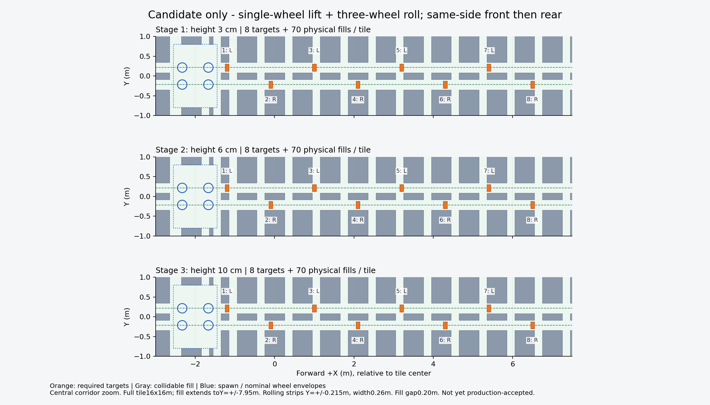
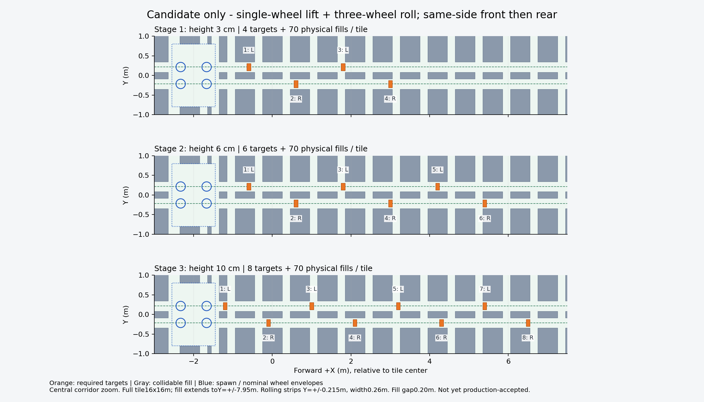

# Dense lift-roll: isolated native screening

## Native outcome: diagnostic fixture unresolved, production withheld

CandidateRef447d0b8; production baseline5a366ff. Exact equal8 manifest in
all3rows, realUSD centers/sizes/roles across all columns verified before
the first placement. Only stage1 live scan/support was reached; do not
claim all3rows live scan, all-target native recovery or2048capacity pass.

First recovery placement:56physics ticks, geometry_verified=true,
support_verified=true, pose_verified=false. First pose failuretick21;
maxrooterror.0215689447m,maxjointerror.0575752258rad,nonwheelforce0,
minhorizontalmargin.007877864m. Probe stopped without completion marker;
PID3310 exited,GPU1MiB. Log `/tmp/m1-lift-roll-native-20261011.log`.

Single-variable control uses exactly the same probe/settings/criteria,
changing only recovery rootX to the empty spawn location. Same56ticks,
same geometry/support pass,pose false firsttick21;
maxrooterror.0215764400m,maxjointerror.0576834679rad,nonwheelforce0,
minmargin.218631089m. PID3458 exited,GPU1MiB. Log
`/tmp/m1-lift-roll-spawn-control-20261011.log`. Both diagnostics were
exclusive under the production flock, no training concurrent.

Conclusion: obstacle contact is not needed to reproduce this pose-validity
failure. Loaded settling under existing actuators is a plausible mechanism,
not fully isolated from all fixture effects. Do not call layout impossible,
erase transient evidence, increase stiffness, add a controller, or relax
runtime3cm success. Task3 remains incomplete until a valid dynamic/support
diagnostic establishes acceptance; production is NOT changed or resumed.

Equal8 amendment independent review found no Critical/Important; rollback
requires old shared m1_mixed_course.py as well as selector. Reviewer did
not certify native/dynamics/2048capacity/all-pose bypass/learned skill.
Fresh17-file CPU regression214passed4.63s (CUDA hidden, no GPU test overlap).
Paired contracts/dashboard/index updated. No need to reapprove count/action.

Final read-only check:948/2750/3310/3458 absent,GPU0=1MiB. Production
mixed_course/semantic_course/registry hashes still match the pre-probe
backup; no deployment occurred. Native log SHA256
`13e3eb01349137d09cbd1edacb68db14b8c5bf8370da4fdc923b05b62da9c234`;
spawn-control log SHA256
`0e2679b87cdb4be4affca3012a24a5ec78b4b4626802b14d9794a09ed62b528b`.
Reproduction source/summary helper archived alongside equal8 CPU JSONs.

Publication: normal non-force push completed; independent ls-remote matched
`ffe9ed8ad32de7fc253ecf5702fd9514e362cdd7` on GitHub `m1-10-11`, including
equal8 implementation447d0b8, role/candidate code,README and evidence.
This publishes an explicitly unaccepted candidate, not production readiness.
Old untracked watcher scripts and PT files were not staged. Production source
remains unchanged; only current notes/README are synchronized to production.

## 04:40UTC checkpoint boundary reached

One-shot helper validatedmodel1400 and SIGINTed onlyPID948. Both exited;
GPU01MiB verified before native launch. model1400 independent CPU validation:
SHA256 `485352c9280e28288f0f39243b59553a344a1f8cf87ec620f01266147734e3c1`,
iter1400/next1401,39finite weights/33finite optimizer states/16positive std,
stage1/streak0,pending0. PT.last2069completedepisodes/pass.1014983084,
2630strictattempts/0success. Next resume boundary1401, not historical1000/1300.

Equal8 reruns: all3rows96nominal recovery samples each,minXYmargin.010792m,
terminal margin.166292m; fullbody56-layer search again no exit within bounds
(maxX.51/.50/-.61m);3984 hypothetical fold/translate/recover positions no
source-convex obstacle intersections. Archived equal8 JSONs under artifacts.
These authorize isolated screening, not policy mastery or all-pose proof.

## User amendment: identical counts/layout, height only

User explicitly corrected the candidate to identical obstacle counts, changing
only height. All three stages now use8targets atX=-1.2+1.1i/Yalternating±.215,
same horizontal shapes and70fills; only3/6/10cm heights differ. Stage0/mixed4+
unchanged. New equality test observedRED([4,6,8]!=[8,8,8]), then full17-file
regression **214passed4.31s**. Only isolated candidate was synced, not production.
New bounded CPU/native checks use this manifest; earlier4/6/8 evidence below
is historical, not deployment authorization for the amended layout.

## Scope / method

T306 `lift-roll-layout/native-readiness`, following the approved
[spec](../../docs/superpowers/specs/2026-10-11-m1-alternating-lift-roll-design.md)
and [whole-body evidence](2026-10-11-m1-fullbody-candidate-search.md).
Inline current-mirror implementation. No swing/controller/teacher or PPO data
from diagnostic placements. Explicit `m1_lift_roll` authoring uses20cm gaps,
70physical fills plus4/6/8 targets. Stage0/mixed4+ stay legacy; production
still selects `m1_progressive`. Candidate files only in the local mirror and
remote `/tmp/m1-lift-roll-candidate-20261011`.

Figure generated from `candidate_blocks(row,fill_gap=.20)` by the archived
figure script; central corridor zoom only. Physical fill spans the full tile.

## Tests / review

Authoring RED4→GREEN: exact shapes/roles/centers, unique paths, semantic-small,
registry counts and legacy rows. Review found two Important measurement
issues: early transient collision/pose drift omitted; side-force counted as
ground support. Seven diagnostic counterexamples RED→GREEN. Combined17-file
regression **213 passed4.24s**, not full-repository tests.

Every physics tick now records requested/measured root/joints, source-mesh
wheel bottoms, force vectors and all-geometry clearance. Support requires
upward force>10N, bottom within4mm of floor and horizontal free space; lifted
wheel unloaded. All-tick geometry/pose evidence cannot be erased by settling;
last5ticks must support. Diagnostic2cm/5degree/.04rad drift bounds classify
sample validity, not runtime crossing thresholds. Static fixture failure is
not proof that the approved three-wheel rolling action is impossible.

## Live checkpoint preparation

04:24UTC PID948 cmdline/cwd matched original2048env run10-56-34/bb57e7d,
stdout1343, GPU21862MiB. CPUmodel1300: iter1300/next1301,39finite weights,
33finite optimizer states,16positive std,stage1,actor1589/critic1592/actions16,
CUDA uninitialized. SHA256
`daf2ed704972a3e469dfbfa33c583fd914c56368f2428220d177c6bad253252a`.
PT.last2059completedepisodes/pass.1219038368/1730strictattempts/0success.

Bounded one-shot helper PID2750 waits for model1400 CPU validation before
SIGINT only to PID948, checking starttime224786776/cwd/cmd.30min timeout,
no restart behavior. Avoid discarding updates1301 onward. Native not started.
Raw TB through1351: recurringprelift(max6/rollout),stable/strict0,stage1,
finite losses; old-layout evidence, not candidate efficacy.

## Acceptance / follow-up

Wait for model1400/process exit/GPU release, then isolated4env native under
the existing kernel lock. No failing/unverified candidate may replace
production.2048env capacity and actual continuous policy crossing remain
separate gates. No all-pose anti-bypass/no-slip/balance or learned10cm claim.
VerifiedProduction5a366ff; Task2f7a12d1. Relevant sources: semantic_course.py,
m1_lift_roll_probe_checks.py,probe_m1_lift_roll_layout.py and their tests.
